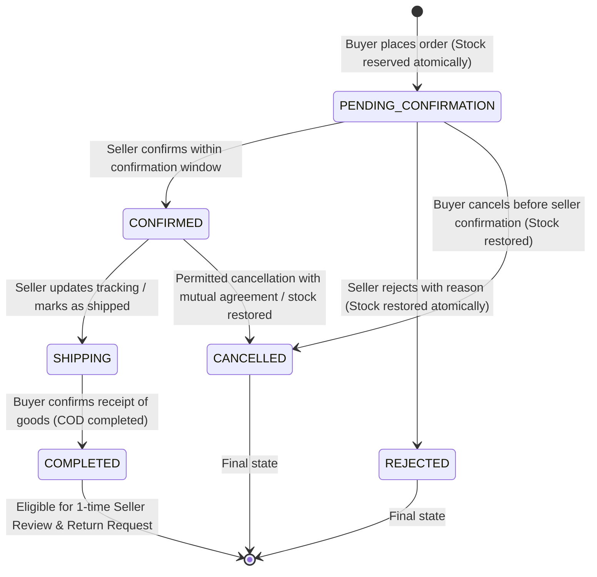

# BUSINESS RULES & LOGICAL SPECIFICATIONS – REMARKET

## 1. Core Principles

1. **Condition Transparency**: Sellers must explicitly declare conditions across standardized fields for each category and declare known defects. Product condition is declared by the seller; the platform and AI do not certify authenticity or remaining lifespan.
2. **Transaction Integrity**: Order status transitions follow a strict state machine enforced by backend business logic.
3. **Atomic Inventory Reservation**: Second-hand items are often single-quantity or strictly limited. Overselling is physically prevented through atomic database transactions.

---

## 2. Order Lifecycle State Machine

### Transition Authority Matrix

| Transition | From State | To State | Authorized Role | Inventory Action |
| :--- | :--- | :--- | :--- | :--- |
| Create Order | `[Init]` | `PENDING_CONFIRMATION` | Buyer | `stockQuantity -= qty`, `reservedQuantity += qty` |
| Confirm Order | `PENDING_CONFIRMATION` | `CONFIRMED` | Seller | None (stock remains locked) |
| Reject Order | `PENDING_CONFIRMATION` | `REJECTED` | Seller | `stockQuantity += qty`, `reservedQuantity -= qty` |
| Buyer Cancel | `PENDING_CONFIRMATION` | `CANCELLED` | Buyer | `stockQuantity += qty`, `reservedQuantity -= qty` |
| Ship Order | `CONFIRMED` | `SHIPPING` | Seller | `reservedQuantity -= qty` (permanent decrement) |
| Confirm Delivery | `SHIPPING` | `COMPLETED` | Buyer (or Auto-Complete after timeout) | None |

> [!IMPORTANT]
> Buyers CANNOT mark orders as `SHIPPING`.
> Sellers CANNOT mark orders as `COMPLETED` on behalf of buyers.
> Buyers CANNOT cancel once the order enters `SHIPPING` (must file a Return/Dispute after delivery).

---

## 3. Cart & Multi-Seller Policy (MVP Rule)

- **Rule**: One checkout transaction can only contain products from **one single seller**.
- **User Experience Handling**:
  - The cart displays all items grouped by seller.
  - When the user selects items for checkout, checkboxes or "Checkout with this Seller" buttons ensure only items from the chosen seller proceed to checkout.
  - If a user attempts to combine products from different sellers in a single checkout, the app alerts the user and prevents order submission.
  - Cart totals, delivery fees, and stock availability are always re-validated against Firestore immediately before the transaction is finalized.

---

## 4. Atomic Inventory Reservation Policy

To prevent two buyers from purchasing the last available unit of a second-hand product concurrently:
1. When checking out, a Firestore transaction (`runTransaction`) is executed.
2. The transaction reads the current `productDoc`.
3. If `productDoc.stockQuantity < requestedQuantity` or `productDoc.status !== 'active'`, the transaction immediately aborts with an `OUT_OF_STOCK` exception.
4. If sufficient stock exists, `stockQuantity` is decremented. If `stockQuantity` becomes `0`, the status updates to `sold_out`.
5. If the seller rejects the order or buyer cancels while in `PENDING_CONFIRMATION`, a reverse transaction restores `stockQuantity` and reverts `sold_out` to `active`.

---

## 5. Reviews & Ratings Rules

1. Only verified buyers of a `COMPLETED` order can submit a review.
2. Exactly 1 review per completed order is permitted.
3. Sellers cannot review their own listings or transactions.
4. Once submitted, the seller's aggregated `ratingAverage` and `ratingCount` are recalculated atomically in Firestore.

---

## 6. AI Ethical & Technical Guardrails

1. **Smart Listing Assistant**:
   - Gemini analyzes uploaded images + user notes.
   - Outputs: suggested category, title draft, suggested tags, and highlighted questions (e.g., "Are the scratches on the bezel or screen?").
   - **Crucial Rule**: The seller MUST explicitly review, edit, and confirm every field. The app marks AI suggestions as `[Draft - Please verify]`. AI never guarantees authenticity, working condition, or battery lifespan.
2. **Visual Search**:
   - Buyer uploads a query image.
   - Gemini extracts visual descriptors (color, shape, brand cues, item type).
   - The query searches active listings matching those criteria.
   - If no listings match, the UI clearly displays "No matching second-hand items found" with suggestions to broaden search keywords.
