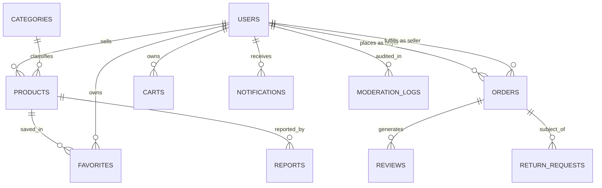

# DATABASE SCHEMA & DATA MODEL – REMARKET

## 1. Firestore Collections Overview

ReMarket uses Cloud Firestore with normalized core entities and denormalized immutable snapshots for historical transaction integrity.



---

## 2. Detailed Collection Schemas

### 2.1 Collection: `users`
Document ID: `uid` (matching Firebase Auth UID)

```json
{
  "uid": "string (unique)",
  "email": "string (unique)",
  "displayName": "string",
  "phoneNumber": "string",
  "avatarUrl": "string | null",
  "role": "buyer_seller | admin",
  "status": "active | suspended",
  "ratingAverage": 4.8,
  "ratingCount": 15,
  "totalSales": 12,
  "totalOrders": 8,
  "defaultAddressId": "string",
  "addresses": [
    {
      "id": "string",
      "recipientName": "string",
      "phoneNumber": "string",
      "street": "string",
      "ward": "string",
      "district": "string",
      "city": "string",
      "isDefault": true
    }
  ],
  "createdAt": "Timestamp",
  "updatedAt": "Timestamp"
}
```

### 2.2 Collection: `categories`
Document ID: Auto-generated or slug (`electronics`, `clothing`, `books`, `home_appliances`)

```json
{
  "id": "string",
  "name": "string",
  "slug": "string",
  "icon": "string",
  "description": "string",
  "displayOrder": 1,
  "isActive": true,
  "conditionFieldSchema": [
    {
      "fieldKey": "workingCondition",
      "label": "Working Condition",
      "type": "select",
      "required": true,
      "options": ["Like New (100% Functional)", "Normal Wear (Fully Functional)", "Minor Glitches", "Needs Repair / Parts Only"]
    },
    {
      "fieldKey": "batteryHealth",
      "label": "Battery Health (%)",
      "type": "number",
      "required": false,
      "min": 1,
      "max": 100
    },
    {
      "fieldKey": "screenCondition",
      "label": "Screen Condition",
      "type": "select",
      "required": true,
      "options": ["Flawless (No Scratches)", "Micro Scratches", "Visible Scratches", "Cracked Screen"]
    },
    {
      "fieldKey": "includedAccessories",
      "label": "Included Accessories",
      "type": "multiselect",
      "required": false,
      "options": ["Original Box", "Original Charger", "Fast Cable", "Case/Cover", "Manual"]
    }
  ],
  "createdAt": "Timestamp"
}
```

### 2.3 Collection: `products`
Document ID: Auto-generated UUID / Firestore ID

```json
{
  "id": "string",
  "sellerId": "string (FK to users)",
  "sellerName": "string",
  "sellerAvatar": "string | null",
  "sellerRating": 4.8,
  "name": "string",
  "categoryId": "string (FK to categories)",
  "categoryName": "string",
  "description": "string",
  "price": 12500000,
  "originalPrice": 25000000,
  "stockQuantity": 1,
  "reservedQuantity": 0,
  "images": [
    "https://storage.googleapis.com/.../img1.jpg",
    "https://storage.googleapis.com/.../img2.jpg"
  ],
  "primaryImage": "https://storage.googleapis.com/.../img1.jpg",
  "condition": {
    "overallRating": "Like New | Very Good | Good | Acceptable",
    "workingCondition": "Like New (100% Functional)",
    "screenCondition": "Flawless",
    "batteryHealth": 89,
    "includedAccessories": ["Original Charger", "Case/Cover"],
    "additionalNotes": "Used for 8 months in office environment"
  },
  "knownDefects": [
    "Small pinhole scratch on bottom right corner (see photo 4)"
  ],
  "deliveryInfo": {
    "methods": ["Standard Delivery", "Express Delivery", "Direct Meetup"],
    "shippingFeeEstimate": 30000
  },
  "location": {
    "city": "Ho Chi Minh City",
    "district": "District 1"
  },
  "status": "pending_approval | active | sold_out | hidden | rejected",
  "rejectionReason": "string | null",
  "viewCount": 142,
  "favoriteCount": 18,
  "createdAt": "Timestamp",
  "updatedAt": "Timestamp"
}
```

### 2.4 Collection: `orders`
Document ID: Auto-generated UUID / Firestore ID
*Notice: Preserves immutable snapshot of item prices, seller details, and declared condition at moment of checkout.*

```json
{
  "id": "string",
  "orderNumber": "RM-20261030-9481",
  "buyerId": "string (FK to users)",
  "buyerName": "string",
  "buyerPhone": "string",
  "buyerAddress": {
    "recipientName": "string",
    "phoneNumber": "string",
    "street": "string",
    "ward": "string",
    "district": "string",
    "city": "string"
  },
  "sellerId": "string (FK to users)",
  "sellerName": "string",
  "items": [
    {
      "productId": "string",
      "productName": "iPhone 13 128GB Midnight",
      "primaryImage": "https://storage.googleapis.com/...",
      "price": 10500000,
      "quantity": 1,
      "categoryName": "Electronics",
      "conditionSnapshot": {
        "overallRating": "Very Good",
        "workingCondition": "Fully functional",
        "batteryHealth": 88,
        "knownDefects": ["Light scratch on metal bezel"]
      }
    }
  ],
  "subtotal": 10500000,
  "deliveryFee": 30000,
  "totalAmount": 10530000,
  "paymentMethod": "COD",
  "paymentStatus": "pending | paid",
  "status": "PENDING_CONFIRMATION | CONFIRMED | SHIPPING | COMPLETED | REJECTED | CANCELLED",
  "rejectionReason": "string | null",
  "cancellationReason": "string | null",
  "trackingCode": "VNPOST-8291039",
  "shippingProvider": "Standard Delivery",
  "statusHistory": [
    {
      "previousStatus": null,
      "newStatus": "PENDING_CONFIRMATION",
      "actorId": "buyer_uid",
      "actorRole": "buyer",
      "timestamp": "Timestamp",
      "reason": "Order placed via COD"
    },
    {
      "previousStatus": "PENDING_CONFIRMATION",
      "newStatus": "CONFIRMED",
      "actorId": "seller_uid",
      "actorRole": "seller",
      "timestamp": "Timestamp",
      "reason": "Seller confirmed availability and packed order"
    }
  ],
  "isReviewed": false,
  "hasDispute": false,
  "createdAt": "Timestamp",
  "updatedAt": "Timestamp"
}
```

### 2.5 Collection: `carts`
Document ID: `userId` (1 cart per registered user)

```json
{
  "userId": "string",
  "items": [
    {
      "productId": "string",
      "sellerId": "string",
      "sellerName": "string",
      "productName": "string",
      "price": 10500000,
      "primaryImage": "string",
      "quantity": 1,
      "maxStock": 1,
      "isAvailable": true,
      "addedAt": "Timestamp"
    }
  ],
  "updatedAt": "Timestamp"
}
```

### 2.6 Collection: `favorites`
Document ID: `${userId}_${productId}`

```json
{
  "id": "string",
  "userId": "string",
  "productId": "string",
  "createdAt": "Timestamp"
}
```

### 2.7 Collection: `reviews`
Document ID: Auto-generated

```json
{
  "id": "string",
  "orderId": "string (unique constraint: 1 review per completed order)",
  "productId": "string",
  "sellerId": "string",
  "buyerId": "string",
  "buyerName": "string",
  "buyerAvatar": "string | null",
  "rating": 5,
  "comment": "Product condition exactly matched the description. Fast delivery!",
  "createdAt": "Timestamp"
}
```

### 2.8 Collection: `reports`
Document ID: Auto-generated

```json
{
  "id": "string",
  "reporterId": "string",
  "reporterName": "string",
  "targetType": "product | user",
  "targetId": "string",
  "reason": "misleading_condition | counterfeit | prohibited_item | harassment | other",
  "description": "Seller claimed battery is 95% but serial check reveals replaced parts",
  "evidenceImages": ["url1", "url2"],
  "status": "pending | under_review | resolved | dismissed",
  "adminDecision": {
    "adminId": "string",
    "actionTaken": "listing_hidden | warning_issued | account_suspended | none",
    "note": "Listing hidden due to confirmed misleading photos",
    "decidedAt": "Timestamp"
  },
  "createdAt": "Timestamp",
  "updatedAt": "Timestamp"
}
```

### 2.9 Collection: `returnRequests` & `complaints`
Document ID: Auto-generated

```json
{
  "id": "string",
  "orderId": "string",
  "buyerId": "string",
  "buyerName": "string",
  "sellerId": "string",
  "sellerName": "string",
  "type": "return_request | transaction_complaint",
  "reason": "defect_not_declared | wrong_item | damaged_in_transit | seller_unresponsive",
  "explanation": "Item has a deep crack on screen that was omitted from the condition declaration",
  "evidenceImages": ["url1", "url2"],
  "status": "submitted | under_review | approved | rejected",
  "adminResolution": {
    "adminId": "string",
    "decision": "refund_approved | dispute_rejected",
    "explanation": "Condition photos submitted by buyer clearly show defect absent from seller listing",
    "resolvedAt": "Timestamp"
  },
  "createdAt": "Timestamp",
  "updatedAt": "Timestamp"
}
```

### 2.10 Collection: `notifications`
Document ID: Auto-generated

```json
{
  "id": "string",
  "recipientId": "string",
  "type": "ORDER_CREATED | ORDER_CONFIRMED | ORDER_SHIPPED | ORDER_COMPLETED | ORDER_CANCELLED | LISTING_APPROVED | LISTING_REJECTED | DISPUTE_UPDATE",
  "title": "Order Confirmed!",
  "body": "Seller Nam has confirmed your order RM-20261030-9481 and is packing your item.",
  "data": {
    "orderId": "string",
    "screen": "OrderDetail",
    "params": { "orderId": "string" }
  },
  "isRead": false,
  "createdAt": "Timestamp"
}
```

### 2.11 Collection: `moderationLogs`
Document ID: Auto-generated

```json
{
  "id": "string",
  "adminId": "string",
  "adminEmail": "string",
  "action": "APPROVE_LISTING | REJECT_LISTING | HIDE_LISTING | SUSPEND_USER | RESOLVE_DISPUTE",
  "targetType": "product | user | dispute",
  "targetId": "string",
  "reason": "Violation of product condition honesty policy",
  "timestamp": "Timestamp"
}
```
