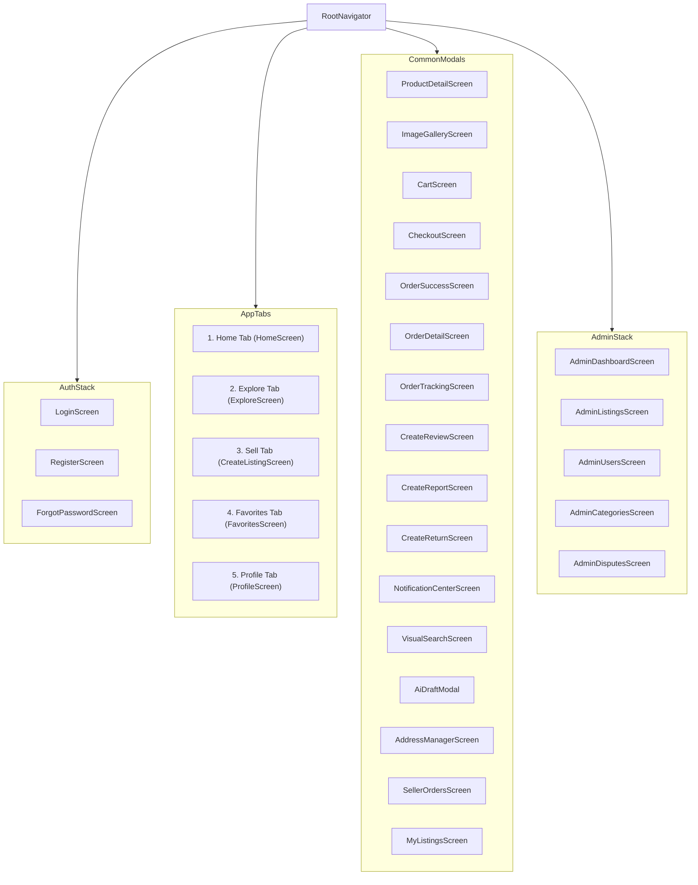

# NAVIGATION FLOW & SCREEN INVENTORY – REMARKET

## 1. Top-Level Navigation Hierarchy

---

## 2. Screen Inventory & Access Matrix

| Screen Name | Route Path | Guest Allowed | Registered User | Admin Only | Description |
| :--- | :--- | :---: | :---: | :---: | :--- |
| **Login** | `Auth/Login` | Yes | - | - | Email/Password login, link to register/forgot |
| **Register** | `Auth/Register` | Yes | - | - | User registration with input validation |
| **ForgotPassword** | `Auth/ForgotPassword` | Yes | - | - | Password reset email trigger |
| **Home** | `Main/Home` | Yes | Yes | Yes | Banner, category list, featured & recent items |
| **Explore** | `Main/Explore` | Yes | Yes | Yes | Search, price/condition filters, sorting |
| **VisualSearch** | `Main/VisualSearch` | Yes | Yes | Yes | AI visual reference photo search |
| **ProductDetail** | `Product/Detail` | Yes | Yes | Yes | Condition breakdown, defects, seller stats, buy/cart |
| **ImageGallery** | `Product/Gallery` | Yes | Yes | Yes | Fullscreen pinch-to-zoom multi-image viewer |
| **Sell / CreateListing**| `Main/Sell` | Prompt Login | Yes | Yes | Dynamic category condition form + AI draft |
| **Favorites** | `Main/Favorites` | Prompt Login | Yes | Yes | User's bookmarked products |
| **Cart** | `Cart/Main` | Prompt Login | Yes | Yes | Cart with 1-seller validation & subtotal |
| **Checkout** | `Cart/Checkout` | No | Yes | Yes | Delivery address, COD payment, price confirmation |
| **OrderSuccess** | `Cart/Success` | No | Yes | Yes | Order confirmation & tracking CTA |
| **BuyerOrders** | `Orders/BuyerList` | No | Yes | Yes | Buyer purchase history by status |
| **OrderDetail** | `Orders/Detail` | No | Yes | Yes | Item snapshots, status tracker, cancellation/confirm |
| **SellerOrders** | `Seller/Orders` | No | Yes | Yes | Incoming orders, confirm/reject, shipping tracker |
| **MyListings** | `Seller/Listings` | No | Yes | Yes | Manage inventory, edit, hide, see views/favorites |
| **CreateReview** | `Review/Create` | No | Yes | Yes | Star rating & comments for completed orders |
| **CreateReport** | `Dispute/Report` | No | Yes | Yes | Report scam, counterfeit, or misleading condition |
| **CreateReturn** | `Dispute/Return` | No | Yes | Yes | Submit return/complaint with photo evidence |
| **Notifications** | `Notifications/List`| No | Yes | Yes | In-app order & listing status updates |
| **Profile** | `Main/Profile` | Prompt Login | Yes | Yes | User profile, addresses, buyer/seller/admin shortcuts |
| **AddressManager** | `Profile/Addresses` | No | Yes | Yes | Manage delivery addresses with default picker |
| **AdminDashboard** | `Admin/Dashboard` | No | No | Yes | Platform KPIs, gross order value, pending queues |
| **AdminListings** | `Admin/Listings` | No | No | Yes | Approve, reject, or hide listings |
| **AdminUsers** | `Admin/Users` | No | No | Yes | View user list, suspend or reactivate |
| **AdminCategories** | `Admin/Categories` | No | No | Yes | Add/edit categories & dynamic condition fields |
| **AdminDisputes** | `Admin/Disputes` | No | No | Yes | Arbitrate returns & reports with audit logs |
