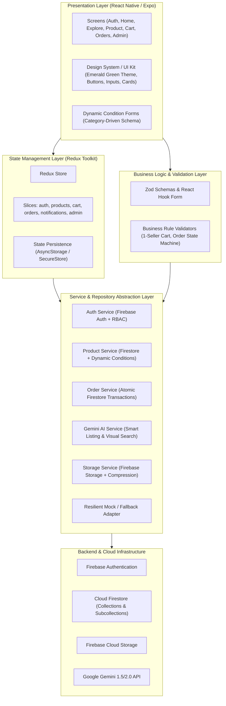

# PROJECT ARCHITECTURE – REMARKET MOBILE APPLICATION

## 1. High-Level Architecture Overview

ReMarket is built using a clean, layered mobile architecture designed for React Native and Expo SDK 58. The architecture enforces strict separation of concerns, transactional integrity, and reactive state management.



## 2. Directory Structure Blueprint

```
d:/MMA301/Code/Project/
├── assets/                  # Icons, splash images, branding assets
├── docs/                    # Technical specifications, schema docs, diagrams
├── src/
│   ├── config/              # App configuration, Firebase initialization, Gemini API
│   │   ├── firebase.ts      # Firebase client config & emulators
│   │   ├── gemini.ts        # Gemini AI prompt templates & config
│   │   └── theme.ts         # Emerald Green design tokens, colors, typography, spacing
│   ├── constants/           # Static constants, default categories, order statuses
│   │   ├── categories.ts    # Initial categories and condition schema templates
│   │   ├── orderStatus.ts   # Order state machine definitions & transitions
│   │   └── routes.ts        # Navigation route names
│   ├── types/               # TypeScript interfaces and type definitions
│   │   ├── auth.ts          # User, Role, Address interfaces
│   │   ├── product.ts       # Product, Condition, Defect interfaces
│   │   ├── order.ts         # Order, Snapshot, Timeline interfaces
│   │   ├── cart.ts          # Cart item and multi-seller grouping
│   │   ├── dispute.ts       # Reports, Returns, Complaints
│   │   ├── notification.ts  # Notification payload and types
│   │   └── navigation.ts    # React Navigation param lists
│   ├── utils/               # Helper functions
│   │   ├── currency.ts      # VND / USD formatting
│   │   ├── date.ts          # Human-readable timestamps
│   │   ├── validation.ts    # Zod schemas for all forms
│   │   └── imageCompress.ts # Client-side image scaling & compression
│   ├── services/            # Service repositories
│   │   ├── authService.ts
│   │   ├── productService.ts
│   │   ├── conditionService.ts
│   │   ├── cartService.ts
│   │   ├── orderService.ts  # Atomic inventory reservation logic
│   │   ├── reviewService.ts
│   │   ├── disputeService.ts
│   │   ├── notificationService.ts
│   │   ├── adminService.ts
│   │   ├── aiService.ts     # Gemini Smart Listing & Visual Search
│   │   └── storageService.ts
│   ├── store/               # Redux Toolkit store & slices
│   │   ├── index.ts
│   │   └── slices/
│   │       ├── authSlice.ts
│   │       ├── productSlice.ts
│   │       ├── cartSlice.ts
│   │       ├── orderSlice.ts
│   │       ├── notificationSlice.ts
│   │       └── adminSlice.ts
│   ├── components/          # Reusable UI components
│   │   ├── common/          # Button, Input, Card, Badge, Modal, Skeleton, EmptyState
│   │   ├── forms/           # ControlledInput, DynamicConditionForm, ImageUploader
│   │   ├── product/         # ProductCard, ProductGrid, ConditionTag, DefectBadge
│   │   └── order/           # OrderCard, StatusTimeline, SellerOrderActions
│   ├── navigation/          # React Navigation navigators
│   │   ├── RootNavigator.tsx
│   │   ├── AppTabs.tsx
│   │   ├── AuthStack.tsx
│   │   ├── AdminStack.tsx
│   │   └── NavigationService.ts
│   └── screens/             # UI Screen components
│       ├── auth/            # Login, Register, ForgotPassword
│       ├── home/            # Home, CategoryBrowse
│       ├── explore/         # Search, VisualSearch, FilterModal
│       ├── product/         # ProductDetail, ImageGallery, SellerProfile
│       ├── sell/            # CreateListing, EditListing, AiDraftModal
│       ├── cart/            # CartScreen, CheckoutScreen, OrderSuccess
│       ├── orders/          # BuyerOrders, OrderDetail, Tracking
│       ├── seller/          # SellerOrders, ManageListings, SalesStats
│       ├── reviews/         # CreateReview, SellerReviews
│       ├── disputes/        # ReportScreen, ReturnRequestScreen, DisputeDetail
│       ├── notifications/   # NotificationCenter
│       ├── profile/         # ProfileScreen, EditProfile, AddressManager
│       └── admin/           # Dashboard, UserManage, ListingModeration, DisputeResolve
├── App.tsx                  # Root Application Component
├── app.json                 # Expo project config
├── package.json             # Dependencies and scripts
└── tsconfig.json            # Strict TypeScript configuration
```

## 3. Technology Stack Specification

- **Framework**: React Native 0.88 + Expo SDK 58
- **Language**: TypeScript (strict mode enabled)
- **Navigation**: React Navigation v6/v7 (Native Stack, Bottom Tabs)
- **State Management**: Redux Toolkit (RTK) + Redux Thunk
- **Form Handling**: React Hook Form + Zod
- **Backend Infrastructure**: Firebase v10/v11 (Auth, Cloud Firestore, Cloud Storage)
- **AI Integration**: Google Gemini API (Structured JSON generation, Multimodal vision analysis)
- **UI & Icons**: Custom Emerald Design System + `@expo/vector-icons` (Ionicons, MaterialCommunityIcons)
- **Local Storage / Caching**: `@react-native-async-storage/async-storage`
